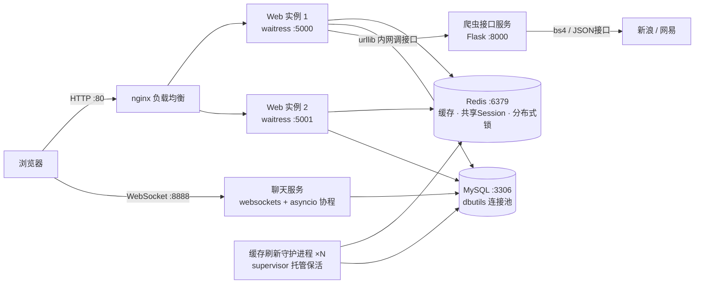

# Flask-Redis 分布式多进程服务系统

> 一个把 Web 主站、爬虫数据接口、WebSocket 长连接、缓存刷新守护进程拆分为**多个独立进程协作**的小型分布式系统，演示了多实例负载均衡、Redis 共享 Session、分布式锁、缓存穿透/击穿/雪崩防护等分布式部署的核心要素。

## 一张图看懂架构



**大白话**：主站像饭店前台，MySQL 是仓库，Redis 是前台手边的便签（常用的先抄上去，不用每次跑仓库）；8000 端口是隔壁专门买菜（爬新闻）的小店；WebSocket 是随时能说话的电话热线；supervisor 是店长，谁翘班就喊谁回来；nginx 是排队叫号机，客人分给任意一个空闲的前台——所以前台（Web 实例）可以随客流随时加人（水平扩容）。

## 技术栈

| 层 | 技术 | 说明 |
|---|---|---|
| Web 框架 | Flask 3 | 学生/新闻管理、登录（session） |
| 生产服务器 | waitress + gevent | 替代 Flask 开发服务器；gevent 猴子补丁演示协程并发 |
| 负载均衡 | nginx | upstream 轮询多实例，`deploy/nginx.conf` |
| 缓存 | Redis 5 | Cache-Aside；SCAN 替代 KEYS；TTL+抖动防雪崩；空值缓存防穿透 |
| 分布式锁 | Redis `SET NX EX` + Lua | 多副本守护进程互斥，`Code/redis_lock.py` |
| 共享 Session | flask-session | session 存 Redis，多实例登录态互通 |
| 数据库 | MySQL + dbutils 连接池 | 每请求独立连接（flask.g + teardown 归还） |
| 进程托管 | supervisor | 后台守护进程崩溃自动拉起，`supervisor/*.ini` |
| 长连接 | websockets + asyncio | 协程聊天服务 |
| 爬虫 | urllib + BeautifulSoup | 独立 JSON 接口服务（8000 端口） |
| 压测 | Locust | 缓存命中 vs 穿透对比，`bench/locustfile.py` |
| 编排 | docker-compose | nginx ×1 + web ×2 + api + ws + mysql + redis，`deploy/docker-compose.yml` |

## 核心亮点（面试可以直接讲的话）

1. **多实例水平扩容**：nginx 轮询两个 waitress 实例；session 已迁移到 Redis（服务端），实例无状态，扩容只需加进程——"为什么能加实例"的标准答案是**登录态不再绑在单机上**。
2. **分布式锁防重复劳动**：缓存刷新守护进程跑 2 个副本时，每轮刷新先抢 `SET NX EX` 锁（随机 token + Lua 原子释放），实测输出：一个副本干活，另一个打印"本轮跳过（分布式锁生效）"。
3. **缓存三件套**：`KEYS` → `SCAN`（不阻塞 Redis）；TTL + 随机抖动（防集中过期雪崩）；查无此人也缓存空值哨兵 + 短 TTL（防恶意穿透，实测第二次请求直接被缓存拦截）。
4. **每请求独立数据库连接**：发现教学版共用全局 cursor 的并发隐患后，改为 `flask.g` 挂独立连接 + `teardown_request` 自动归还。
5. **配置与代码解耦**：全部地址/端口/密码走环境变量与 `.env`（12-Factor 第 3 条），docker 编排里改环境变量即指向不同容器，代码零修改。
6. **压测验证设计**：Locust 50 并发实测——点查询命中缓存 p50 5ms，穿透到库 p50 8ms；单机小数据集差距约 40%，并分析出本机压测差距受限于 MySQL 就在隔壁（详见下文压测表）。
7. **安全实践**：SQL 全程参数化查询防注入；输出转义防 XSS；`SECRET_KEY` 走环境变量；密码不落 session。

## 压测数据（Locust，本机实测，50 并发 / 30s / 0 错误）

| 场景 | 请求量 | 中位延迟 | 平均延迟 | 吞吐 |
|---|---|---|---|---|
| 点查询_命中缓存 | 2318 | **5ms** | 7ms | 78.5 req/s |
| 点查询_穿透到库（每次删缓存） | 770 | **8ms** | 9ms | 26.1 req/s |
| 首页（列表缓存） | 3275 | 12ms | 13ms | 111 req/s |

> 复现：`pip install locust` → `locust -f bench/locustfile.py --host http://127.0.0.1:5000`（本机单进程小数据集，差距约 40%；数据集和查询越重、数据库越远，差距越大——这也是"缓存优先保护数据库"的意义）。

## 快速开始

### 方式一：本机直接跑（Windows / Linux 通用）

```bash
# 1. 装依赖（建议虚拟环境）
pip install -r requirements.txt

# 2. 准备数据库：执行建表脚本（改好 Code/.env 里的连接信息）
mysql -uroot -p < schema.sql
cp .env.example .env    # 按需修改，默认连本机

# 3. 分别起服务（四个窗口，也可以交给 supervisor 托管）
python Code/http_server.py        # 爬虫接口 :8000
python Code/websocket_server.py   # 聊天 :8888
python Code/start_server.py       # 主站 :5000（waitress）
python Code/redis_listen_wangyi_sina.py   # 缓存刷新守护进程

# 4. 浏览器访问 http://localhost:5000（登录用 student 表数据，如 李军 / 2511班）
```

### 方式二：docker compose 一键编排（需安装 Docker Desktop）

```bash
cd deploy && docker compose up -d --build
# 访问 http://localhost（nginx 进来，后面挂了两个 web 实例）
```

### 方式三：supervisor 托管（生产姿势，崩溃自动拉起）

```bash
supervisord -c supervisor/supervisord.conf   # 启动托管（Windows 用 supervisor-win）
supervisorctl status                          # 查看托管进程状态
```

## 目录结构

```
R_project/
├── Code/                    # 全部源码
│   ├── App.py               # Flask 主站（路由、缓存读写、Session）
│   ├── config.py            # 统一配置（环境变量 > .env > 默认值）
│   ├── cache_utils.py       # 缓存工具：SCAN / TTL+抖动 / 空值哨兵
│   ├── redis_lock.py        # Redis 分布式锁（NX+EX / token / Lua 释放）
│   ├── redis_pool.py        # Redis 连接池
│   ├── mysql_pool.py        # MySQL 连接池（dbutils）
│   ├── checkFunc.py         # 事务装饰器 + 登录校验 + 分页
│   ├── start_server.py      # waitress 生产入口
│   ├── http_server.py       # 爬虫 JSON 接口服务 :8000
│   ├── websocket_server.py  # WebSocket 聊天 :8888
│   ├── redis_listen_*.py    # 缓存刷新守护进程（带分布式锁）
│   ├── templates/ static/   # 页面模板与静态资源
│   └── logging.conf         # 日志（按天切割）
├── supervisor/              # 进程托管配置（web / 双缓存刷新）
├── deploy/                  # nginx.conf + docker-compose.yml + Dockerfile
├── bench/locustfile.py      # 压测脚本（缓存命中 vs 穿透）
├── schema.sql               # 建表 + 种子数据
├── docs/讲解手册.md          # 每个模块怎么给面试官讲（含追问应对）
└── 面试笔记.md               # 知识点复习笔记
```

## 说明

- 本项目为学习演示用途：登录即学生表校验（class 字段兼作密码），生产环境需替换为正式认证体系。
- `docs/讲解手册.md` 是这个项目的"使用说明书"——每个设计点都有"是什么 / 为什么 / 30 秒讲法 / 追问怎么答"。
